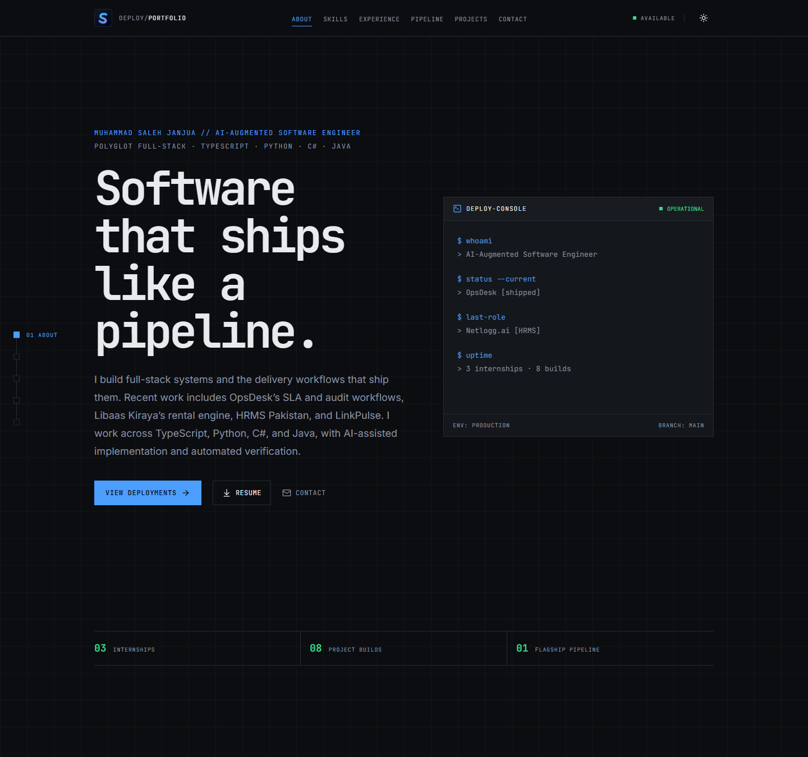

# Muhammad Saleh Janjua | Engineering Portfolio

**AI-Augmented Software Engineer · Polyglot Full-Stack · Delivery**

[View the live portfolio](https://portfolio-salesmayn.vercel.app) ·
[GitHub](https://github.com/salesmayn-code) ·
[LinkedIn](https://www.linkedin.com/in/muhammadsalehjanjua) ·
[Email](mailto:MuhammadSalehJanjua@gmail.com)

> Software that ships like a pipeline: staged, verified, and deployed.

This repository powers my personal engineering portfolio. I build full-stack systems and
the delivery workflows around them, working across TypeScript/Next.js, Python/FastAPI,
C#/.NET, and Java/Spring Boot. I use AI-assisted implementation and test generation, then
review and verify the result with automated tests and CI.

The home page leads with OpsDesk, Libaas Kiraya, and HRMS Pakistan. The rest of the work
lives in the [project archive](https://portfolio-salesmayn.vercel.app/projects).

## Preview

## Engineering focus

- Building full-stack systems across TypeScript/Next.js, Python/FastAPI, C#/.NET, and Java/Spring Boot
- Designing APIs, PostgreSQL data models, RBAC, SLA/audit workflows, and transactional outbox patterns
- Using AI-assisted implementation and test generation with human review, then validating through automated tests and CI/CD
- Shipping with Jenkins, GitHub Actions, Docker, PM2, and Nginx

## Selected work

### [OpsDesk](https://github.com/salesmayn-code/OpsDesk)

A full-stack IT service management platform covering ticket lifecycles, SLA automation,
role-based access, asset management, incident and change workflows, and audit trails. Built
with Next.js, NestJS, PostgreSQL, Prisma, Redis, and BullMQ.

### [Libaas Kiraya](https://github.com/salesmayn-code/libaas-kiraya) (In development)

A multi-vendor occasion-wear rental marketplace built with Medusa v2 and Next.js. It handles
vendor onboarding and approval, date-aware availability with database-enforced rental
windows, 15-minute holds, rental checkout, deposits, inspections, disputes, and payouts.

### HRMS Pakistan (Private project)

A single-organization HR management system covering employee records, attendance, leave,
compensation, payroll, approvals, and reporting, with role-based access and audit-ready
workflows. Built during a software engineering internship at Netlogg.ai. The repository is
private; the portfolio card summarises the delivered work.

### [Mimaar Associates CI/CD Pipeline](https://github.com/salesmayn-code/MimaarAssociates)

An end-to-end Jenkins delivery pipeline for a Next.js and TypeScript platform. The workflow
automates linting, testing, Prisma migrations, production builds, and deployment to Ubuntu
behind Nginx and PM2. The portfolio includes an interactive visualization of the release
sequence.

### [Cryptojacking Detection Tool](https://github.com/salesmayn-code/Cryptojacking_Detection_Tool)

A final-year security project that monitors CPU and memory behavior to identify unauthorized
cryptocurrency mining. It combines Python monitoring, FastAPI services, alerting, machine
learning, SQLite, and a React dashboard.

### [Agile Capacity Tracker](https://github.com/salesmayn-code/AgileCapacityTracker)

A full-stack sprint and team-capacity dashboard with a Java/Spring Boot backend, a Next.js
interface, PostgreSQL, and GitHub issue synchronization.

### [Pixel Art Canvas](https://github.com/MuhammadSalehJanjua/Pixel-art-canvas)

A browser-based pixel art tool with a responsive grid drawing interface and real-time HTML5
Canvas rendering.

### [LinkPulse](https://github.com/salesmayn-code/LinkPulse) (In development)

A self-hostable URL shortener and click-analytics dashboard built with .NET 10, ASP.NET Core,
Blazor, Clerk, and SQL Server. Next: rate limiting, health checks, telemetry, and deployment
verification.

## Professional experience

- **Software Engineering Intern, Netlogg.ai (July-October 2026):** Built HRMS Pakistan, a
  full-stack HR management system covering employee records, attendance, leave, compensation,
  payroll, approvals, and reporting. Worked across the Next.js application, PostgreSQL/Prisma
  data model, and server-side authorization, and contributed to deployment and supporting
  implementation work.
- **Web Engineering Intern, Mimaar Associates:** Full-stack product work, PostgreSQL and
  Firebase integration, authentication hardening, and Jenkins delivery automation.
- **Front-end Developer Intern, InzeMarketing:** Responsive interface development,
  Lighthouse performance improvements, analytics integration, and SEO enhancements.

## Portfolio identity

The interface uses a deployment-control-surface aesthetic inspired by the systems I build:

- A live terminal-style engineering status console
- A staged, animated CI/CD pipeline walkthrough
- Status colors with consistent meaning: passed, running, queued, and failed
- JetBrains Mono for technical hierarchy and Inter for readable body content
- Dark and light themes with reduced-motion accessibility support
- A flagship-first home page with a separate project archive and live GitHub activity feed
- An AI-augmented workflow using agents for scoped implementation and test generation, with human review and verification

## Technical foundation

| Area         | Technologies                                                    |
| ------------ | --------------------------------------------------------------- |
| Application  | Next.js 16, React 19, TypeScript                                |
| Interface    | Tailwind CSS 4, Framer Motion, shadcn/ui                        |
| Validation   | React Hook Form, Zod                                            |
| Integrations | GitHub API, Vercel Analytics                                    |
| Delivery     | pnpm, ESLint, Prettier, Husky, lint-staged                      |
| Workflow     | Agent-assisted implementation, AI test generation, human review |
| Hosting      | Vercel                                                          |

## Contact

I am open to AI-augmented software engineering, full-stack/backend, and platform or delivery roles.

**Muhammad Saleh Janjua**

[MuhammadSalehJanjua@gmail.com](mailto:MuhammadSalehJanjua@gmail.com)
